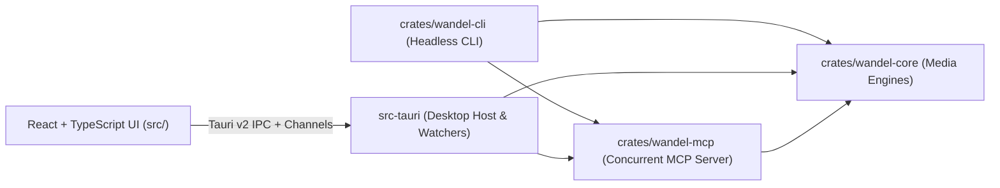

# Wandel Architecture & Performance Guide

This document describes Wandel's internal architecture, concurrency model, crate layout, and performance optimizations.

---

## Workspace Overview

Wandel is structured as a 4-crate Cargo workspace paired with a React + TypeScript + Tailwind CSS v4 frontend:

| Crate / Directory | Responsibility |
| :--- | :--- |
| `crates/wandel-core` | Pure-Rust image engine, FFmpeg/FFprobe video & audio engine, pure-Rust PDF suite, batch scheduler, smart naming, and metadata inspector. |
| `crates/wandel-mcp` | Zero-bloat JSON-RPC 2.0 MCP server over newline-delimited stdio with concurrent request dispatch, `--allowed-dir` sandboxing, `dryRun`, and `wandel_pipeline`. |
| `crates/wandel-cli` | Standalone headless `wandel` binary exposing all conversion/utility subcommands, `wandel pipeline`, and `wandel mcp`. |
| `src-tauri` | Tauri v2 desktop shell: commands, bundled FFmpeg/FFprobe sidecar resolution, `notify` Watch Folders, and System Tray / Menu Bar integration. |
| `src/` | React 19 + TypeScript + Tailwind CSS v4 UI with Vitest unit tests (`100%` utility coverage). |

---

## Parallelism & Performance Optimizations

### 1. Multi-Core Image Processing (`rayon` + SIMD `fast_image_resize`)
- **Batch Parallelism:** `run_batch` in `crates/wandel-core/src/scheduler.rs` processes image and PDF jobs concurrently across all logical CPU cores via a configurable `rayon::ThreadPool`.
- **SIMD Resizing:** `fast_image_resize` uses NEON (Apple Silicon / ARM64) and AVX2/SSE4.1 (x86_64) Lanczos3 convolution kernels.
- **Parallel Pixel Passes & Zero-Copy Buffers (`v2.2.0`):** Heavy RGBA transforms (`apply_auto_levels`, `apply_filter_preset`, `adjust_saturation`, `apply_vignette`) operate in parallel via `rayon::par_chunks_exact_mut` and consume owned buffers with `into_rgba8()` to avoid redundant 4K/8K buffer clones.
- **Cached System Font Database (`OnceLock`):** `resvg`/`usvg` system font loading is cached once globally via `OnceLock<Arc<fontdb::Database>>` instead of scanning OS font directories on every watermarked image.

### 2. Adaptive GPU & Multi-Process Video Scheduling
- **Startup Hardware Probing:** `probe_hardware()` tests working GPU encoders once (`h264_videotoolbox`/`hevc_videotoolbox` on macOS, `nvenc`/`qsv`/`amf` on Windows, `nvenc`/`vaapi`/`qsv` on Linux) and caches `HardwareCapabilities`.
- **Graceful CPU Fallback:** If a hardware encoder rejects a stream's pixel format or dimensions, `convert_video()` automatically falls back to software encoding (`libx264`/`libx265`) without failing the batch.
- **Adaptive Concurrency:** Video jobs run concurrently up to `max_concurrent_videos` (defaulting to 2–4 parallel FFmpeg workers depending on CPU/GPU) with per-process thread budgets so CPU and GPU pipelines stay saturated without thrashing.
- **Zero-Re-encode Fast Paths:** `remux_only` (`-c copy`) and `split_media_segments` (`-c copy -f segment`) bypass decoding/encoding entirely.

### 3. 100% Pure-Rust PDF Stack
No Ghostscript, Poppler, or PDFium binaries required:
- **Images → PDF & Compress PDF:** `pdf-writer` with parallel `rayon` JPEG page preparation.
- **PDF → Images:** `hayro` (pure-Rust PDF rasterizer with embedded fonts) parallelized per page.
- **Lossless PDF Ops:** `lopdf` for merge, split, rotate, reorder, diagonal text stamp, page numbering, embedded image extraction, and metadata scrubbing.

### 4. Concurrent MCP Server (`crates/wandel-mcp`)
- Probes FFmpeg & GPU capabilities **once** at server startup (`Arc<McpContext>`).
- Dispatches concurrent `tools/call` frames on a bounded worker pool (`cpu_cores.clamp(4, 16)`) with an atomic stdout writer mutex.
- Supports `notifications/cancelled` (per-request `AtomicBool`) and `notifications/progress` streaming.

---

## CI/CD & Quality Gates

- **CI (`.github/workflows/ci.yml`):**
  - `frontend`: `npm run test:coverage` (100% thresholds on `src/types.ts` & `src/i18n.ts`) + `npm run build`.
  - `rust`: Matrix across `ubuntu-latest`, `macos-latest`, and `windows-latest` running `cargo clippy --workspace --all-targets -- -D warnings` and `cargo test --workspace`.
  - `coverage`: `cargo-llvm-cov` generating `lcov.info` and publishing summaries to `$GITHUB_STEP_SUMMARY`.
- **Release (`.github/workflows/release.yml`):**
  - Gated behind a `verify` job.
  - Builds Tauri Desktop installers + standalone headless `wandel-cli` archives with `.sha256` checksums for **macOS arm64**, **macOS x64**, **Linux x64**, and **Windows x64**.
